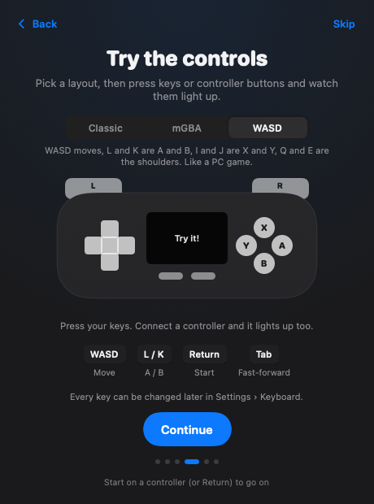
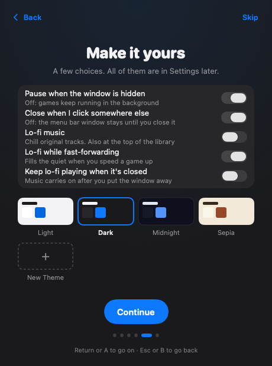
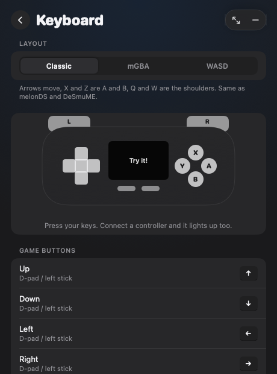

# Menu Bar Emulator

Game Boy, Game Boy Color, Game Boy Advance and Nintendo DS games, living in your Mac's menu bar. Click the icon (or press your shortcut), play, and click away: it pauses and saves itself.

**Early build.** Things might break. Feedback and tips: [ko-fi.com/kian](https://ko-fi.com/kian)

<p>



</p>

## Features
- Lives in the menu bar, or pops out as a floating window with your own shortcut. Full screen too.
- Pauses and saves when hidden; resume where you left off. Save states, rewind, fast-forward, slow motion, turbo.
- Any game controller, everywhere, including all the menus. Keyboard layouts: Classic, mGBA or WASD.
- 12 DS screen layouts, the mouse as the stylus, and a separate touch-screen window.
- Cheats and IPS / UPS / BPS mod patches, box art or your own pictures, custom themes.
- Built-in lo-fi music: an original 30-minute mix made in code. Turn it on, or have it play while you fast-forward.

## Install
1. Download the latest zip from [Releases](../../releases) and drag **Menu Bar Emulator** into Applications.
2. The first time, double-click it. It isn't notarized by Apple yet, so macOS blocks it once: click **Done**, then go to System Settings → Privacy & Security, scroll down, and click **Open Anyway** next to Menu Bar Emulator.
3. A controller icon appears in the menu bar, and the welcome tour does the rest.

Needs macOS 26 on an Apple Silicon Mac. **No games, BIOS files, saves, or save states are included.** Add ROMs you own.

## Build from source
```bash
git clone https://github.com/Kiasora/menu-bar-emulator.git
cd menu-bar-emulator
brew install cmake ninja
./build-cores.sh
open MenuBarEmulator.xcodeproj
```
`build-cores.sh` downloads pinned emulator-core sources into the ignored `cores/` folder, excluding their upstream ROM/save test folders. It builds them into `BuiltCores/`, which Xcode copies into the app. Then press ⌘R.

Tests run with ⌘U. Tests requiring real ROMs are skipped unless optional development fixtures are supplied in the ignored `LocalTestFixtures/ROMs/` folder or through `MENU_BAR_EMULATOR_TEST_ROMS`. No ROM fixtures are included in this repository or the app.

## Credits and licenses
- [mGBA](https://github.com/mgba-emu/mgba) (GB, GBC, GBA): Mozilla Public License 2.0
- [melonDS](https://github.com/melonDS-emu/melonDS) and [melonDS DS](https://github.com/JesseTG/melonds-ds) (DS): GNU GPL 3.0
- [libretro-common](https://github.com/libretro/libretro-common): MIT. Box art from [libretro-thumbnails](https://github.com/libretro-thumbnails/libretro-thumbnails); it belongs to its owners.

This app is released under the **GNU GPL 3.0** (see `LICENSE`), because it ships with GPL-licensed melonDS.

Game Boy, Game Boy Color, Game Boy Advance and Nintendo DS are trademarks of Nintendo. This project isn't affiliated with or endorsed by Nintendo.
